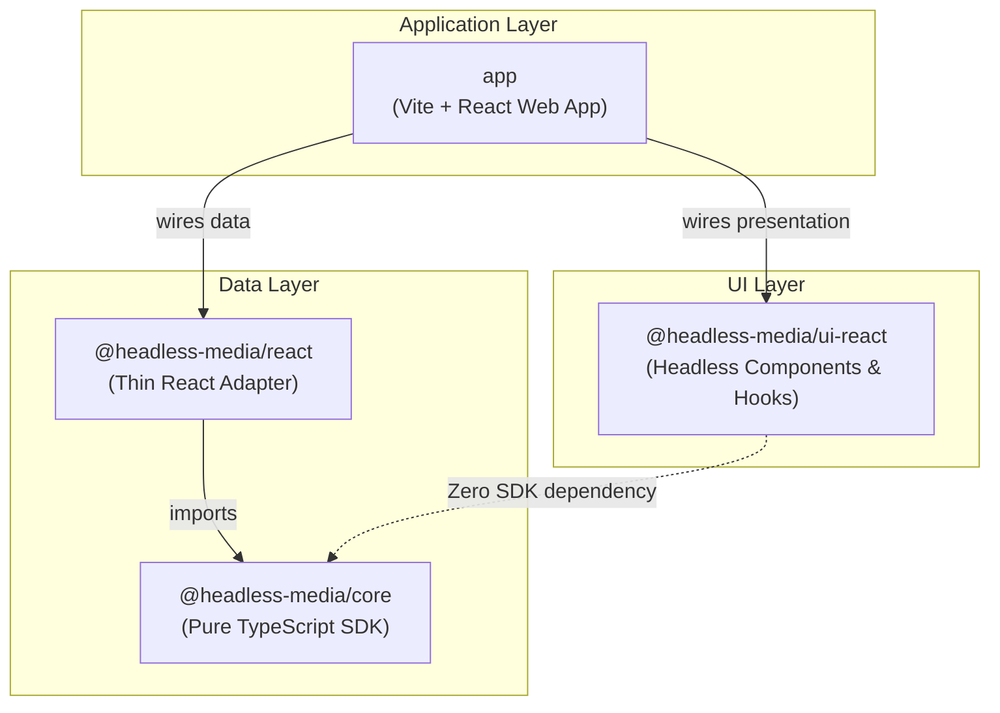

# Headless Media SDK & Component Library (React & TypeScript)

A production-grade, headless architecture for browsing, searching, and previewing photos and videos from Pexels. Built exclusively with **React** and **TypeScript** using **npm workspaces**.

---

## 📌 Scope Note & Architecture Boundaries

This repository implements the **React web deliverables** of the take-home task for a React.js Developer role:
- `packages/media-core`: Framework-independent pure TypeScript SDK.
- `packages/media-react`: Thin React adapter context and hooks.
- `packages/media-ui-react`: Headless React UI library (Grid, Lightbox, ReelSwiper).
- `app`: Vite + React + TypeScript web application integration.
- Two practical AI agent skills (`wiring-media-data` and `using-headless-media-ui`).

> **Scope Note**: React Native packages, Expo/Metro configuration, mobile wrappers, and native UI components from the original prompt are **intentionally omitted** as this submission focuses strictly on React and TypeScript web engineering.

---

## 🏗️ Architecture & Dependency Direction

The solution is divided into strictly decoupled layers with unidirectional dependencies:



### Strict Boundary Rules
1. **`media-core` is pure TypeScript**: Zero imports of React, React DOM, browser DOM types (`Window`, `HTMLElement`), or UI code. It provides an injectable transport interface (`MediaTransport` / `MediaFetchFn`) allowing it to run in Node, Web Workers, or browsers.
2. **`media-react` adapts `media-core` to React**: Provides `<MediaProvider>` and hooks (`useMediaSearch`, `useCuratedMedia`, `useMediaItem`, `useMediaActivity`). It never re-implements API or caching algorithms.
3. **`media-ui-react` is genuinely headless**: Contains **no Pexels knowledge** and **zero SDK imports**. It receives data and callbacks via props and ships **no visual CSS styles**.
4. **`app` is the only integration point**: It wires credentials and state from `media-react` to `media-ui-react`, supplying markup and CSS styling.

---

## 🔄 Request & Event Flow

### 1. Request Flow (UI to Pexels and Back)
```
User Search / Page Load
         │
         ▼
[React Hook: useMediaSearch / useCuratedMedia]
         │
         ▼
[MediaClient: searchPhotos / searchVideos]
         │
    Check in-flight promise? ───► (Return pending Promise)
         │ No
    Check in-memory cache? ─────► (Return cached MediaPageResult)
         │ Miss
         ▼
[Portable Fetch Transport] ─────► Pexels REST API (https://api.pexels.com)
         │
         ▼
[JSON Response + HTTP Status Check]
         │
         ▼
[Data Normalizer: normalizePhoto / normalizeVideo] ──► Unified MediaItem
         │
         ▼
[Stored in MediaCache with TTL]
         │
         ▼
[Hook State Update: items, hasMore, isLoading]
         │
         ▼
[Rendered by headless MediaGrid / ReelSwiper via App Presentation]
```

### 2. Activity Event Flow
```
User opens Lightbox or clicks Download
         │
         ▼
[Hook: recordView(item) / recordDownload(item)]
         │
         ▼
[MediaEventEmitter: emit({ type, item, timestamp })]
         ├─────────────────────────────────────────┐
         ▼                                         ▼
[Safe Console Logger]                     [App State: ActivityDrawer]
"[Media Activity] VIEW: 'Brown Rocks'"    Live counter badge & drawer stream
```

---

## 🔑 Pexels API Key Configuration & Security Warning

### How to Configure Your Key Locally
1. Obtain a free Pexels API key at [pexels.com/api](https://www.pexels.com/api/).
2. Create a local environment file named `.env.local` in the project root:
   ```env
   VITE_PEXELS_API_KEY=your_actual_pexels_api_key_here
   ```
   *(Note: `.env.local` is listed in `.gitignore` and will never be committed).*
3. Alternatively, the web application includes a fallback interactive banner allowing you to enter a key for temporary in-session testing without creating a file.

### ⚠️ Critical Security Notice for Client-Side API Keys
> [!WARNING]
> In any browser-based Single Page Application (SPA), environment variables prefixed with `VITE_` are bundled into the client-side JavaScript code. Any user can inspect their browser's Network tab or JavaScript bundle and view the key.
> 
> **Production Best Practice**: For production deployments, never store third-party paid or rate-limited API keys in client-side code. Instead, route requests through a lightweight **server-side proxy or BFF (Backend-for-Frontend)** (e.g., Next.js Route Handlers, Node/Express, or Cloudflare Workers) that appends the secret header server-side and applies user authentication and rate limiting.

---

## 🚀 Getting Started

### Prerequisites
- **Node.js**: `v20.x` or later (tested on `v20.17.0`)
- **npm**: `v10.x` or later (tested on `10.8.3`)

### 1. Installation
Install all dependencies across the workspace:
```bash
npm install
```

### 2. Type Checking
Run TypeScript type-checking across all packages and the app:
```bash
npm run typecheck
```

### 3. Production Build
Build all packages (`media-core`, `media-react`, `media-ui-react`) and the Vite web application:
```bash
npm run build
```

### 4. Development Server
Start the Vite local development server:
```bash
npm run dev
```
Open [http://localhost:3000](http://localhost:3000) in your browser.

---

## 📦 Package Summary & Features

### 1. `packages/media-core`
- **Client Factory**: `createMediaClient({ apiKey, cacheTtlMs, enableConsoleLogging })`.
- **Portable Transport**: Avoids DOM globals; works with `globalThis.fetch` or custom injected fetch functions.
- **Search & Discovery**:
  - `searchPhotos(query, options)`
  - `searchVideos(query, options)`
  - `getCuratedPhotos(options)`
  - `getPopularVideos(options)`
  - `getPhoto(id)` and `getVideo(id)`
- **In-Memory Cache & In-Flight Deduplication**:
  - TTL-based map eviction.
  - Prevents duplicate simultaneous network requests during React Strict Mode double-invocations.
- **Structured Errors**: `MediaConfigError`, `MediaApiError`, `MediaNetworkError`. Sanitized to never leak the API key.
- **Activity Emitter**: Emits `view` and `download` events with timestamps, detached console logger, and subscriber cleanup.

### 2. `packages/media-react`
- **Context**: `<MediaProvider client={client}>` and `useMediaClient()`.
- **Hooks**:
  - `useMediaSearch`: Manages search query, pagination (`page`, `hasMore`, `loadMore`, `refresh`), loading states (`isLoading`, `isLoadingMore`), and race-condition guards.
  - `useCuratedMedia`: Fetches curated/popular feeds.
  - `useMediaItem`: Fetches single item details.
  - `useMediaActivity`: Subscribes to activity stream with automatic unmount unsubscribe.

### 3. `packages/media-ui-react`
- **100% Headless**: No visual styling; full prop-getter and compound component ergonomics.
- **Grid (`MediaGrid` & `useMediaGrid`)**:
  - Accessible button semantics (`role="button"`, `tabIndex={0}`, `Enter`/`Space`).
  - Automatic infinite scroll with `IntersectionObserver` isolation and browser fallback.
- **Lightbox (`Lightbox` & `useLightbox`)**:
  - Dialog semantics (`role="dialog"`, `aria-modal="true"`).
  - Keyboard navigation (<kbd>Escape</kbd>, <kbd>←</kbd>, <kbd>→</kbd>).
  - Focus trapping inside modal and focus restoration to trigger element on exit.
- **Reel Swiper (`ReelSwiper` & `useReelSwiper`)**:
  - Vertical snap carousel for video feeds.
  - Keyboard navigation (<kbd>↓</kbd>, <kbd>↑</kbd>, <kbd>PageDown</kbd>, <kbd>PageUp</kbd>).
  - Touch swipe gestures and mouse wheel paging.

### 4. `app` (Web Application)
- **Search & Filters**: Search photos/videos, toggle between Photos and Videos, switch to Reels view for video results.
- **Responsive Layout**: CSS Grid cards with badges, metadata, and direct download links.
- **Interactive Lightbox**: Full-resolution preview, video playback, prev/next controls, creator link.
- **Reels Player**: Vertical full-height reels with auto-play on active slide.
- **Activity Log Drawer**: Real-time sliding drawer displaying live `view` and `download` events with timestamping.
- **Interactive Key Notice**: Setup instructions and in-session key entry fallback if `.env.local` is missing.

---

## 🤖 Practical AI Agent Skills

Two specialized agent skills are provided in both `.agents/skills/` (the Antigravity/agent standard) and `skills/`:

1. **`wiring-media-data`** (`.agents/skills/wiring-media-data/SKILL.md`):
   - Step-by-step instructions for initializing `MediaClient`, configuring providers, invoking hooks (`useMediaSearch`, `useCuratedMedia`), managing pagination, and subscribing to activity events.
2. **`using-headless-media-ui`** (`.agents/skills/using-headless-media-ui/SKILL.md`):
   - Detailed guide on using the headless `MediaGrid`, `Lightbox`, and `ReelSwiper` with prop-getters, keyboard accessibility contracts, and focus management.

---

## 📝 Provenance & Contributions

- **Architecture & Implementation**: Authored by a senior React/TypeScript engineer acting as implementation partner and tutor.
- **Code Generation**: All TypeScript contracts, error models, cache structures, React hooks, headless components, and Vite application code were deliberately composed to enforce zero boundary leaks and pass strict TypeScript verification without external UI component dependencies.
- **Verification**: All commands reported (`npm run typecheck`, `npm run build`) were executed directly in the shell environment and verified to succeed with exit code 0.

---

## ⚠️ Known Limitations & API Specifics

1. **Pexels Single Item Endpoints**: Pexels supports `GET /v1/photos/:id` and `GET /videos/videos/:id`. The client normalizes numeric ID strings automatically.
2. **Video Autoplay Policy**: Browsers enforce strict autoplay policies requiring user interaction or mute. In the Reels player, videos are muted by default if unmuted autoplay is blocked by the browser.
3. **Pexels Rate Limits**: Free Pexels API keys have a rate limit of 200 requests per hour. The in-memory cache and in-flight deduplicator help prevent hitting rate limits during development and rapid navigation.

